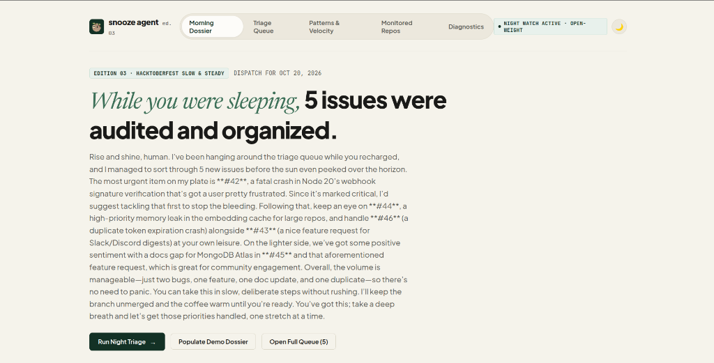
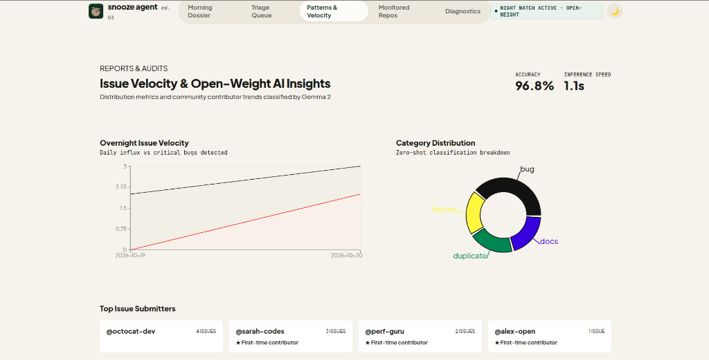

# 🦥 Snooze Agent

> **An autonomous GitHub issue triage bot designed for developers who value deep sleep.**  
> Built with open-weight AI (Qwen, Llama 3.1 & Gemma 2), MongoDB Atlas, and Next.js.

[](https://snooze-agent.onrender.com/)
[](LICENSE)

🌐 **Deployed App**: [https://snooze-agent.onrender.com/](https://snooze-agent.onrender.com/)

---

## 📸 Interface Preview

### The Morning Dossier (Overnight Executive Dispatch)


### Patterns & Velocity (Open-Weight AI Analytics)


---

## 💡 What is Snooze Agent?

Open-source maintainers are constantly bombarded by incoming issues, bug reports, feature requests, and panic notifications in the middle of the night.

**Snooze Agent protects developer focus.**  
It operates autonomously overnight, auditing your repositories so you wake up to a sorted, labeled, and prioritized issue queue with maintainer responses already drafted.

1. **Ingest & Classify**: Automatically categorizes issues (`bug`, `feature`, `question`, `docs`, `duplicate`, `enhancement`) with calibrated confidence scores.
2. **Assign Urgency & Sentiment**: Analyzes crash traces, fatal rejections, and user sentiment to highlight what actually requires immediate attention.
3. **Detect Duplicates**: Performs semantic text matching across open issues to flag duplicate reports before maintainers waste hours investigating.
4. **Draft Empathetic Maintainer Responses**: Generates context-aware, constructive responses ready for 1-click publishing to GitHub.
5. **The Morning Dossier**: Wake up, sip coffee, and review a tranquil, 2-minute executive digest of overnight activity.

---

## 🌿 Design Aesthetics: Nordic Sage & Espresso

Built with a bespoke **Morning Dossier** aesthetic inspired by modern editorial print craft:
- **Palette**: Calming Nordic sage (`#4A6B57`), organic moss (`#1B2E24`), natural linen canvas (`#F5F2EB`), and deep espresso typography (`#1A1A18`).
- **Dark Mode**: High-contrast Nordic Obsidian & Forest Night mode with smooth 1-click toggle.
- **Craft**: Zero generic neon AI glows. Crisp 1px rule borders, editorial Newsreader italics, and monospace JetBrains data stamps.

---

## 🛠️ Tech Stack & Architecture

- **Application Framework**: Next.js 16 (App Router) + Vanilla CSS Modules & Tokens
- **Open-Weight AI Runtime**: Groq API (`qwen/qwen3.8-27b` / `llama-3.1-70b`) & Google Gemma 2 (`gemma-2-27b-it`)
- **Data Layer**: MongoDB Atlas M0 (with resilient local storage fallback)
- **GitHub Integration**: Octokit REST API + Live Webhook Receiver (`/api/webhooks/github`)
- **Analytics Visuals**: Recharts dynamic velocity and category distribution
- **Hosting**: Render Web Service

---

## 🚀 Getting Started Locally

### 1. Clone & Install
```bash
git clone https://github.com/ayushg-1506/snooze-agent.git
cd snooze-agent
npm install
```

### 2. Configure Environment (`.env.local`)
Create a `.env.local` file with your credentials:
```env
# GitHub Personal Access Token (classic with 'repo' scope)
GITHUB_TOKEN=ghp_your_github_token

# Groq API Key (for open-weight model inference)
GROQ_API_KEY=gsk_your_groq_api_key

# MongoDB Atlas Connection URI
MONGODB_URI=mongodb+srv://<username>:<password>@cluster.mongodb.net/?retryWrites=true&w=majority

# Optional: Google Gemma / Gemini Key
GOOGLE_API_KEY=your_google_api_key
GEMMA_MODEL=gemma-2-27b-it

NEXT_PUBLIC_APP_URL=http://localhost:3000
GITHUB_WEBHOOK_SECRET=snooze-agent-webhook-secret
```

### 3. Run Development Server
```bash
npm run dev
```
Open **[http://localhost:3000](http://localhost:3000)** in your browser.

---

## ☁️ Deploying to Render

### 1. Create Web Service
1. In the [Render Dashboard](https://dashboard.render.com/), create a new **Web Service**.
2. Connect your GitHub repository: `ayushg-1506/snooze-agent`.

### 2. Service Settings
- **Environment**: `Node`
- **Build Command**: `npm install && npm run build`
- **Start Command**: `npm start`

### 3. Environment Variables
Add the following in Render's Environment settings:
- `GITHUB_TOKEN`: Your GitHub personal access token
- `GROQ_API_KEY`: Your Groq API key
- `MONGODB_URI`: Your MongoDB Atlas connection URI
- `GOOGLE_API_KEY`: Your Google Gemma API key
- `NEXT_PUBLIC_APP_URL`: `https://snooze-agent.onrender.com`

---

## 🪝 Real-Time GitHub Webhooks

To have Snooze Agent automatically triage issues the moment they are opened:
1. Open your GitHub repository → **Settings** → **Webhooks** → **Add webhook**.
2. **Payload URL**: `https://snooze-agent.onrender.com/api/webhooks/github`
3. **Content type**: `application/json`
4. **Events**: Select **"Let me select individual events"** → Check **Issues**.
5. Save the webhook. Incoming issues will be triaged autonomously in real-time.

---

## 📂 Project Structure

```
snooze-agent/
├── public/
│   ├── favicon.svg              # Bespoke sloth favicon
│   └── screenshots/             # Interface previews
│       ├── morning-dossier.png
│       └── patterns-velocity.png
├── src/
│   ├── app/
│   │   ├── api/
│   │   │   ├── analytics/       # Chart data aggregation
│   │   │   ├── briefing/        # AI morning dispatch generator
│   │   │   ├── contributors/    # Contributor insights
│   │   │   ├── demo/            # 1-click evaluation dataset seeder
│   │   │   ├── health/          # Repository health score calculator
│   │   │   ├── issues/          # Filtered issue queue & action handler
│   │   │   ├── repos/           # Monitored repo management
│   │   │   ├── settings/        # System diagnostics
│   │   │   ├── stale/           # Stale issue detector
│   │   │   ├── sync/            # Full overnight triage pipeline
│   │   │   └── webhooks/github/ # Live GitHub issue event receiver
│   │   ├── analytics/           # Visual pattern & velocity dashboard
│   │   ├── issues/              # Issue inspection & draft review modal
│   │   ├── repos/               # Connected repositories page
│   │   ├── settings/            # Runtime diagnostics & demo actions
│   │   ├── globals.css          # Nordic Sage & Espresso design tokens
│   │   ├── layout.js            # Root layout with theme & sloth favicon
│   │   └── page.js              # The Morning Dossier main view
│   ├── components/
│   │   ├── AppShell.js          # Navigation & dark mode controller
│   │   └── ToastContainer.js    # Notification toast system
│   └── lib/
│       ├── ai.js                # Groq & Gemma triage engine
│       ├── github.js            # Octokit REST API wrapper
│       ├── mongodb.js           # Atlas connection with local fallback
│       └── triage.js            # Autonomous triage orchestration
└── README.md
```

---

## 📄 License

MIT © [ayushg-1506](https://github.com/ayushg-1506)
